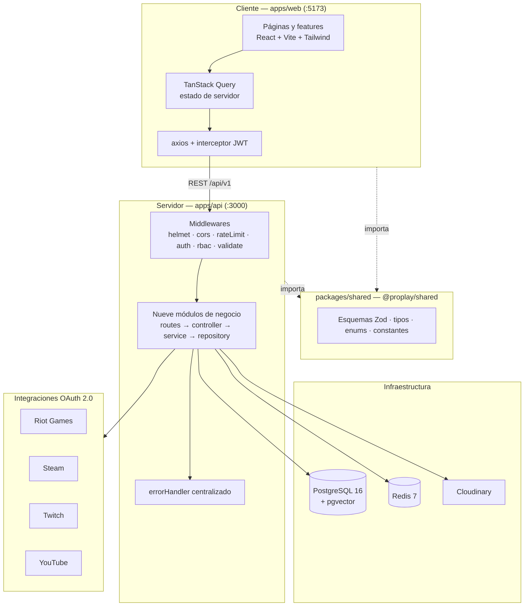
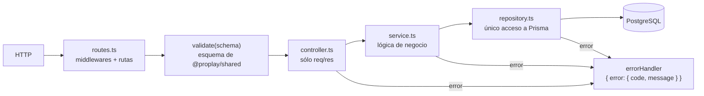
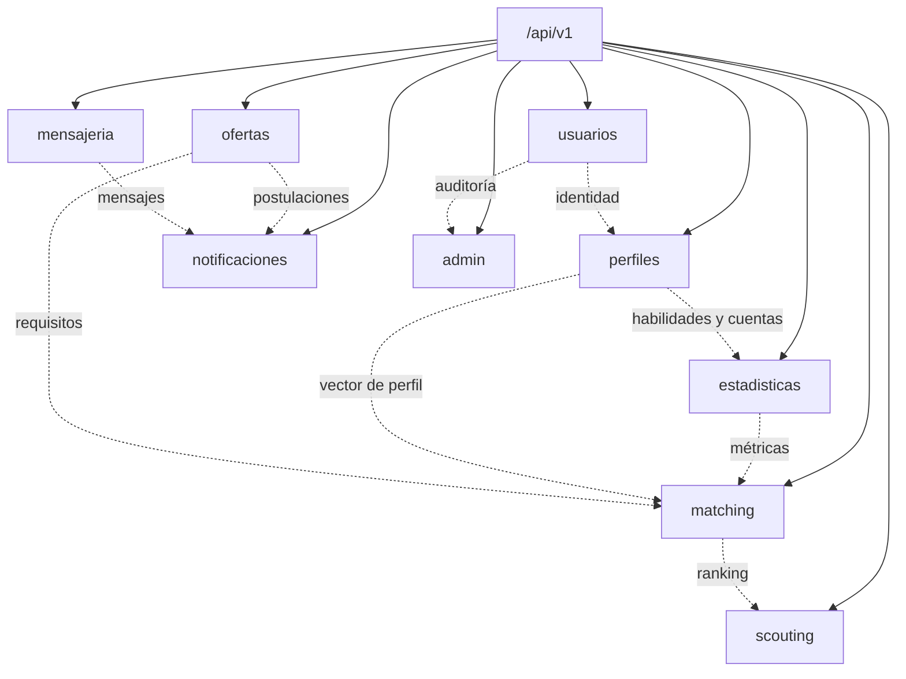
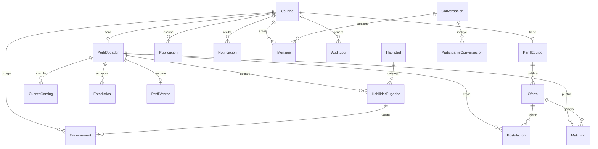
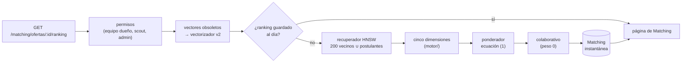
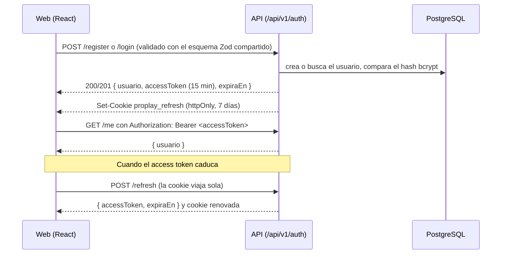

# Arquitectura de ProPlay

## Vista general

Monolito modular en el servidor con cliente desacoplado. Una sola aplicación
Express contiene los nueve módulos de negocio, separados por carpetas y no por
servicios; el contrato de la API vive en un paquete compartido que consumen
tanto el backend como el frontend.

## Capas del servidor

Cada petición recorre siempre el mismo camino. La regla es estricta: un
controlador no toca Prisma y un service tampoco; sólo el repository.

## Los nueve módulos

| Módulo | Responsabilidad | Estado |
| --- | --- | --- |
| `usuarios` | Registro, login, refresco de sesión, `/me`, gestión de cuentas y auditoría de acceso | **Implementado** |
| `perfiles` | Perfil de jugador y de equipo, catálogo de habilidades, niveles, endorsements y vinculación de cuentas gaming | `GET /me` y `PATCH /jugador` implementados; el resto, andamiaje (501) |
| `estadisticas` | Métricas por jugador, juego y periodo; sincronización con las plataformas externas | Andamiaje (501) |
| `scouting` | Búsqueda y descubrimiento de jugadores con filtros de juego, rol, región y rendimiento; búsquedas guardadas | Andamiaje (501) |
| `matching` | Algoritmo de compatibilidad jugador ↔ oferta y ranking persistido | Ranking (`GET /ofertas/:id/ranking`) y recálculo implementados; `GET /jugador/me` en 501 |
| `ofertas` | Ofertas de los equipos y postulaciones de los jugadores con sus estados | Andamiaje (501) |
| `mensajeria` | Conversaciones y mensajes 1:1 y de equipo | Andamiaje (501) |
| `notificaciones` | Notificaciones in-app y su estado de lectura | Andamiaje (501) |
| `admin` | Métricas de la plataforma, moderación de cuentas y consulta del `AuditLog` | Andamiaje (501) |

## Modelo de datos

Definido en `apps/api/prisma/schema.prisma`, que hace también de documentación
del modelo.

Notas:

- `PerfilVector.dimensiones` es `Float[]` para que Prisma pueda leerlo y
  escribirlo; la columna `embedding vector(64)` la añade la migración
  `20260910145700_pgvector_perfil_vector` y es la que usa el recuperador del
  motor de matching, con el índice HNSW `PerfilVector_embedding_hnsw_idx`.
- Los tokens de `CuentaGaming` se guardan cifrados con AES-256-GCM.
- Hay índices en las claves foráneas y en los campos por los que se filtra:
  `Oferta.juego`, `Oferta.region`, `Oferta.estado`, `Estadistica.jugadorId`,
  `Matching.ofertaId` y `Matching(ofertaId, puntaje)`.

## Algoritmo de compatibilidad

El motor de matching (`apps/api/src/modules/matching/`) puntúa a cada candidato
con la media ponderada de cinco dimensiones, según la ecuación (1) de la Sección
VIII del documento: S(j, o) = Σ wₖ·dₖ(j, o), con Σ wₖ = 1. Las fórmulas son
funciones puras en `motor/` (sin Prisma ni red); el service las orquesta y el
repository es el único que lee y escribe la base.

Los pesos wₖ los **configura el equipo que publica la oferta** y se guardan en
ella (`Oferta.pesoTecnica`…). `PESOS_MATCHING` (`@proplay/shared/constants`) son
sólo los **pesos por defecto**: los valores con los que arranca el formulario de
la oferta y los que se aplican si el equipo no los ajusta. En el piloto,
experiencia y habilidades blandas van con peso 0 porque no hay datos verificables
con que medirlas (`DIMENSIONES_SIN_DATOS_PILOTO`; `docs/decisiones.md`, «Motor de
matching»): el motor las sigue calculando y el formulario las fija en 0.

| Dimensión | Peso por defecto (piloto) | Qué mide (Sección VIII) |
| --- | --- | --- |
| `tecnica` | 0,50 | Estadísticas de rendimiento del jugador en los videojuegos y roles en los que participa |
| `experiencia` | 0 (sin datos en el piloto) | Historial en equipos, torneos, competencias y logros obtenidos |
| `habilidadesBlandas` | 0 (sin datos en el piloto) | Endorsements de comunicación, trabajo en equipo y liderazgo (habilidades de categoría `BLANDA`) |
| `geografica` | 0,25 | Región del jugador y disponibilidad para relocalización o participación en línea |
| `disponibilidad` | 0,25 | Horarios de práctica y preferencias de compromiso |

La experiencia **no se mide en años**. El modelo de trayectoria que la sostendría
(equipos anteriores, torneos y logros) es trabajo futuro.

El ranking de una oferta lleva, por candidato, los cinco dₖ y una explicación con
datos por dimensión (`rankingOfertaSchema` en `@proplay/shared`). Cuando falta el
dato del jugador, la dimensión se puntúa con 0 (técnica sin cuenta verificada,
experiencia, habilidades blandas) o con el neutro 0,5 (ubicación u horas), y la
explicación lo marca como «faltan datos».

### Recorrido de una petición

- **Sólo datos guardados.** El motor lee `PerfilJugador`, la última captura
  verificada de `Estadistica`, `Endorsement` y `Oferta`; nunca llama a Riot ni
  a nada por red, así que funciona con la clave de desarrollo caducada. Lo
  vigilan una regla de ESLint (`no-restricted-imports` en `modules/matching`) y
  `tests/matching-sin-red.test.ts`.
- **Vectorizador (versión 2, `PERFIL_VECTOR_VERSION`).** 64 dimensiones: posición
  (distribución de partidas), rango y liga, las siete métricas normalizadas,
  volumen de partidas, verificación, macrorregión, fuera de Colombia,
  relocalización, horas y un sesgo constante (nunca hay vectores nulos); de la 34
  a la 63, reservadas a 0. El vector de la oferta vive en el mismo espacio, con
  cada bloque multiplicado por el peso de su dimensión. El detalle está en
  `motor/vectorizador.ts`. El vector **recupera, no puntúa**.
- **Cuándo se recalcula un vector.** Tras cada ingesta con captura nueva (el
  worker llama al motor) y, antes de cada ranking, el de todo jugador cuyo vector
  sea de otra versión o anterior a su última edición, captura o verificación.
  `npm run matching:revectorizar -w api` los recalcula todos.
- **Recuperador.** `ORDER BY embedding <=> $1 LIMIT 200` sobre el índice
  `PerfilVector_embedding_hnsw_idx`, con `SET LOCAL hnsw.ef_search = 200` en la
  misma transacción (con el valor por defecto, 40, el índice pierde vecinos). Se
  añaden siempre los postulantes de la oferta aunque el índice no los traiga.
- **Cuándo se recalcula el ranking.** Al leerlo, si cambió la oferta, algún
  vector, las postulaciones o los endorsements, o la versión de las fórmulas
  (`VERSION_FORMULAS_MATCHING`); y a demanda con `POST …/recalcular`. Cada cálculo
  reemplaza la instantánea de la oferta en `Matching`. Una oferta cubierta o
  cerrada conserva la última.
- **Orden.** Puntaje de mayor a menor; a igualdad, técnica y, por último, el id
  del jugador. Es estable entre páginas.

### Las cinco dimensiones

| Dimensión | Fórmula | Sin datos |
| --- | --- | --- |
| Técnica | 0,25·posición + 0,35·rango + 0,40·rendimiento, de la última captura verificada. Posición: fracción de partidas de solo/dúo en la posición pedida (1 si es la principal). Rango: 1 si cumple el mínimo; baja linealmente y llega a 0 una liga (cuatro divisiones) por debajo; sin mínimo, posición en el catálogo de 0 a 1. Rendimiento: media de las métricas de la posición normalizadas con las escalas fijas (abajo) | 0 con `SIN_CUENTA_VERIFICADA` o `SIN_CAPTURA`; sin rango, la parte de rango vale 0 |
| Experiencia | Sin modelo de trayectoria en el piloto | 0 con `SIN_DATOS_PILOTO` |
| Habilidades blandas | Media, sobre las habilidades `BLANDA` del catálogo, de min(1, endorsements de equipos / 3) | 0 con `SIN_ENDORSEMENTS` |
| Geográfica | Oferta remota: 1. Presencial: mismo departamento 1, misma macrorregión 0,6, mismo país 0,3, otro país 0,1. Híbrida: 1 / 0,8 / 0,5 / 0,2. Con disposición a relocalizarse, al menos 0,75 (presencial) u 0,85 (híbrida). Fuera de Colombia, el mismo país es la coincidencia completa | 0,5 con `SIN_UBICACION` |
| Disponibilidad | min(1, horas del jugador / horas de la oferta); oferta sin horas: 1 | 0,5 con `SIN_HORAS` |

### Escalas fijas de la técnica

Cada métrica se normaliza con `clamp((x − suelo) / (techo − suelo), 0, 1)` contra
una escala fija por posición (`motor/escalas.ts`), no contra percentiles del grupo
del piloto. Con un grupo de decenas de jugadores, los percentiles serían
inestables, harían que el puntaje de un jugador cambiara cuando otro sincroniza (y
obligarían a recalcular todos los rankings con cada ingesta), y no serían una
métrica estandarizada (H2): si el grupo es flojo, inflarían a todos.

Las escalas **no salen de una tabla oficial de Riot**, que no publica
distribuciones por rango ni por posición. Salen del razonamiento sobre la mecánica
del juego que se da en cada fila, y se **calibran con las capturas reales del
piloto**: si una escala satura (casi todos en 0 o en 1), se corrige, se sube
`VERSION_FORMULAS_MATCHING` y se anota en `docs/decisiones.md`. Cuentan en el
rendimiento de cada posición, con el mismo peso:

| Posición | Métricas |
| --- | --- |
| Top | win rate, KDA, CS/min, daño/min, visión/min |
| Jungla | win rate, KDA, CS/min, participación en kills, visión/min |
| Mid | win rate, KDA, CS/min, daño/min, participación en kills |
| ADC | win rate, KDA, CS/min, daño/min, oro/min |
| Soporte | win rate, KDA, visión/min, participación en kills |

| Métrica | Escala (suelo–techo) | Fuente o razonamiento |
| --- | --- | --- |
| Win rate | 0,40–0,60 (todas) | El emparejamiento de clasificatoria busca partidas al 50 % para un jugador en su nivel real: sostener un 60 % en 20 partidas indica que juega claramente por encima de su liga, y un 40 %, por debajo. Con pocas partidas se encoge hacia el 50 % como si hubiera 10 partidas previas al 50 % (5 partidas al 80 % cuentan como 60 %). |
| KDA, (K + A) / M | 1–5; soporte 1,5–6 | Un KDA de 1 es morir tanto como se contribuye a kills; 5 es un jugador que casi no muere y participa en casi todo. El soporte acumula asistencias por su papel, así que su escala se desplaza. |
| CS/min | 4–9; jungla 4–7; no cuenta en soporte | Una oleada sale cada 30 s y el máximo teórico en línea ronda los 10–12 CS/min; 9 sostenido es nivel muy alto y 4 es perder la mitad de la oleada. Los campamentos de la jungla dan menos CS por minuto. El soporte no farmea por diseño (su objeto de soporte se lo penaliza). |
| Oro/min | 300–500; sólo ADC | El tirador es la posición que convierte oro en daño; el oro por minuto refleja a la vez farmeo y participación. En las demás posiciones repetiría al CS/min. |
| Daño a campeones/min | 300–900; top 250–750; cuenta en top, mid y ADC | Mide la presión sobre el rival; en las posiciones de daño es lo que se le pide. El top tiene más campeones resistentes (tanques), con menos daño, y la escala se baja. |
| Visión/min | 0,5–2,5; jungla 0,7–2,5; soporte 1–3,5; cuenta en top, jungla y soporte | La puntuación de visión crece con los guardianes puestos y destruidos. El soporte es el responsable principal de la visión, y la jungla la necesita para moverse por el mapa. |
| Participación en kills | 0,35–0,70; jungla y soporte 0,45–0,80; cuenta en jungla, mid y soporte | Fracción de los kills del equipo en que participó. Las posiciones que se mueven por el mapa (jungla, soporte) participan más por diseño. |

Subpesos de la técnica: la posición (0,25) se puede jugar «de segunda», el rango
(0,35) es la señal más difícil de falsificar de la API, y el rendimiento (0,40)
es lo que más se acerca a «cómo juega». Cualquier cambio de escala, de métrica de
una posición o de subpeso sube `VERSION_FORMULAS_MATCHING`.

## Flujo de autenticación

El access token vive sólo en memoria del cliente; la sesión sobrevive a la
recarga gracias a la cookie `httpOnly`, que el interceptor de axios usa para
refrescar y reintentar la petición fallida una única vez.

## Integraciones externas

Todas cumplen la interfaz `GameStatsProvider`
(`apps/api/src/integrations/GameStatsProvider.ts`) con tres métodos:
`vincularCuenta`, `obtenerEstadisticas` y `refrescarToken`. El registro de
`integrations/index.ts` resuelve el proveedor por plataforma, así que el módulo
`estadisticas` nunca depende de una implementación concreta. Riot es la primera
que se va a conectar y su clase ya documenta los endpoints del camino.
