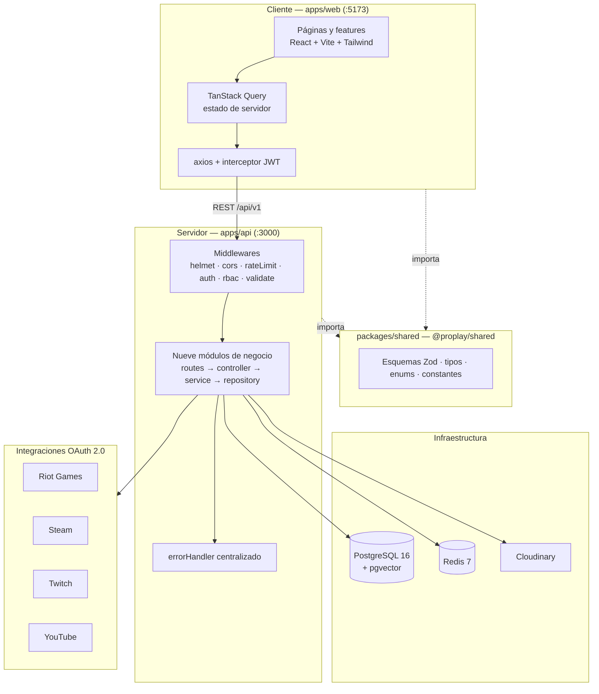
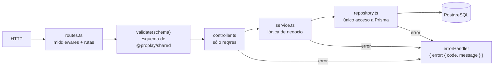
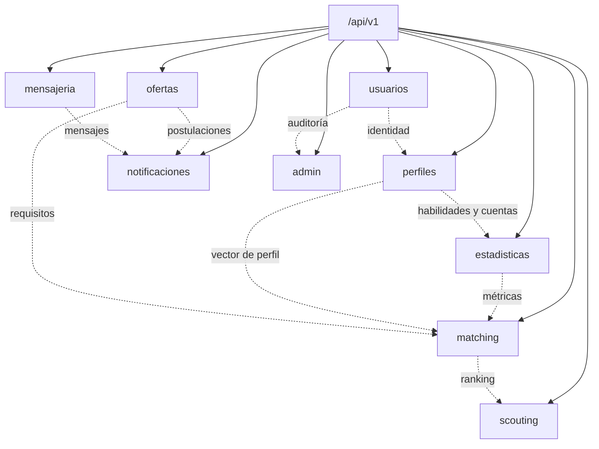
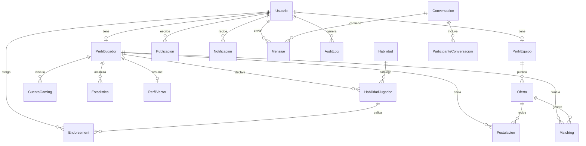
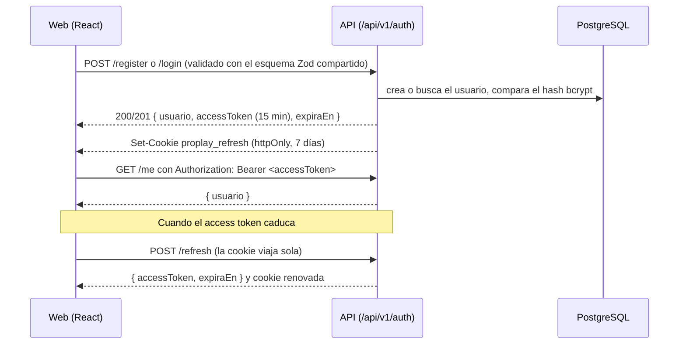

# Arquitectura de ProPlay

## Vista general

Monolito modular en el servidor con cliente desacoplado. Una sola aplicación
Express contiene los nueve módulos de negocio, separados por carpetas y no por
servicios; el contrato de la API vive en un paquete compartido que consumen
tanto el backend como el frontend.

## Capas del servidor

Cada petición recorre siempre el mismo camino. La regla es estricta: un
controlador no toca Prisma y un service tampoco; sólo el repository.

## Los nueve módulos

| Módulo | Responsabilidad | Estado |
| --- | --- | --- |
| `usuarios` | Registro, login, refresco de sesión, `/me`, gestión de cuentas y auditoría de acceso | **Implementado** |
| `perfiles` | Perfil de jugador y de equipo, catálogo de habilidades, niveles, endorsements y vinculación de cuentas gaming | `GET /me` y `PATCH /jugador` implementados; el resto, andamiaje (501) |
| `estadisticas` | Métricas por jugador, juego y periodo; sincronización con las plataformas externas | Andamiaje (501) |
| `scouting` | Búsqueda y descubrimiento de jugadores con filtros de juego, rol, región y rendimiento; búsquedas guardadas | Andamiaje (501) |
| `matching` | Algoritmo de compatibilidad jugador ↔ oferta y ranking persistido | Andamiaje (501), con `calcularCompatibilidad` firmada |
| `ofertas` | Ofertas de los equipos y postulaciones de los jugadores con sus estados | Andamiaje (501) |
| `mensajeria` | Conversaciones y mensajes 1:1 y de equipo | Andamiaje (501) |
| `notificaciones` | Notificaciones in-app y su estado de lectura | Andamiaje (501) |
| `admin` | Métricas de la plataforma, moderación de cuentas y consulta del `AuditLog` | Andamiaje (501) |

## Modelo de datos

Definido en `apps/api/prisma/schema.prisma`, que hace también de documentación
del modelo.

Notas:

- `PerfilVector.dimensiones` es `Float[]` para que Prisma pueda leerlo y
  escribirlo; la columna `embedding vector(64)` la añade la migración
  `20260910145700_pgvector_perfil_vector` y es la que usarán las búsquedas de
  similitud.
- Los tokens de `CuentaGaming` se guardan cifrados con AES-256-GCM.
- Hay índices en las claves foráneas y en los campos por los que se filtra:
  `Oferta.juego`, `Oferta.region`, `Oferta.estado`, `Estadistica.jugadorId`,
  `Matching.ofertaId` y `Matching(ofertaId, puntaje)`.

## Algoritmo de compatibilidad

`calcularCompatibilidad(jugador, oferta)` (en `matching.service.ts`) devuelve
la media ponderada de cinco dimensiones, según la ecuación (1) de la Sección
VIII del documento: S(j, o) = Σ wₖ·dₖ(j, o), con Σ wₖ = 1.

Los pesos wₖ los **configura el equipo que publica la oferta**. `PESOS_MATCHING`
(`@proplay/shared/constants`) son sólo los **pesos por defecto**: los valores con
los que arranca el formulario de la oferta y los que se aplican si el equipo no
los ajusta. Hoy `Oferta` todavía no guarda pesos propios, así que el cálculo usa
siempre los de por defecto; los pesos por oferta llegan con las tareas 3.6 y 3.10
del plan, y la justificación de estos valores, con la tarea que los lleva a la
Sección VIII.

| Dimensión | Peso por defecto | Qué mide (Sección VIII) |
| --- | --- | --- |
| `tecnica` | 0.35 | Estadísticas de rendimiento del jugador en los videojuegos y roles en los que participa |
| `experiencia` | 0.20 | Historial en equipos, torneos, competencias y logros obtenidos |
| `habilidadesBlandas` | 0.15 | Endorsements de comunicación, trabajo en equipo y liderazgo (habilidades de categoría `BLANDA`) |
| `geografica` | 0.15 | Región del jugador y disponibilidad para relocalización o participación en línea |
| `disponibilidad` | 0.15 | Horarios de práctica y preferencias de compromiso |

La experiencia **no se mide en años**. El modelo de trayectoria que la sostiene
(equipos anteriores, torneos y logros) aún no existe en `schema.prisma`; está en
`docs/decisiones.md`, «Pendientes», para resolverse antes del S3 junto con la
tarea 3.5. El campo `Oferta.experienciaMinAnios` es anterior a esta definición y
se revisará entonces.

Hoy devuelve un valor fijo: el contrato y el desglose ya están cerrados; la
implementación de cada dimensión es lo siguiente que toca.

## Flujo de autenticación

El access token vive sólo en memoria del cliente; la sesión sobrevive a la
recarga gracias a la cookie `httpOnly`, que el interceptor de axios usa para
refrescar y reintentar la petición fallida una única vez.

## Integraciones externas

Todas cumplen la interfaz `GameStatsProvider`
(`apps/api/src/integrations/GameStatsProvider.ts`) con tres métodos:
`vincularCuenta`, `obtenerEstadisticas` y `refrescarToken`. El registro de
`integrations/index.ts` resuelve el proveedor por plataforma, así que el módulo
`estadisticas` nunca depende de una implementación concreta. Riot es la primera
que se va a conectar y su clase ya documenta los endpoints del camino.
